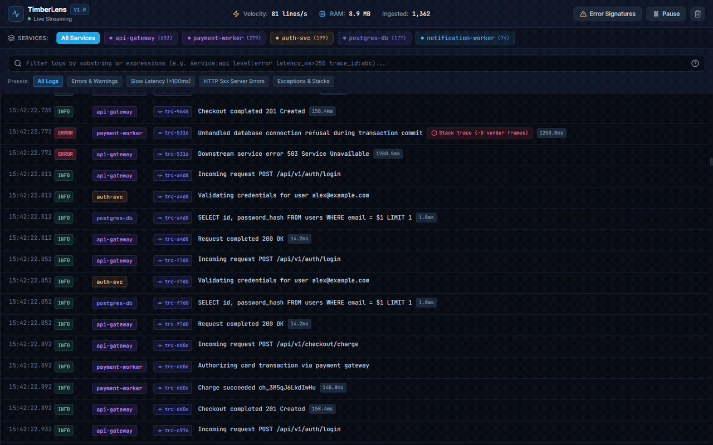
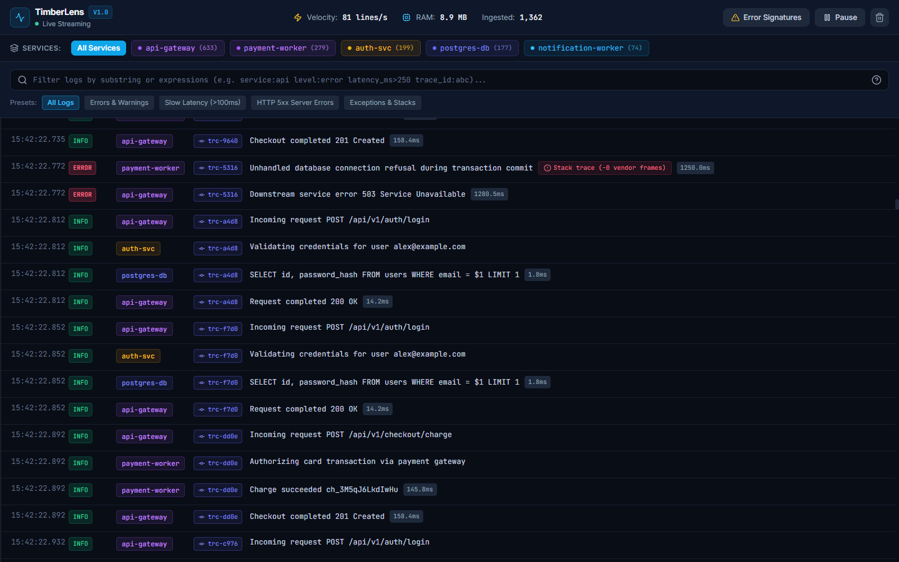
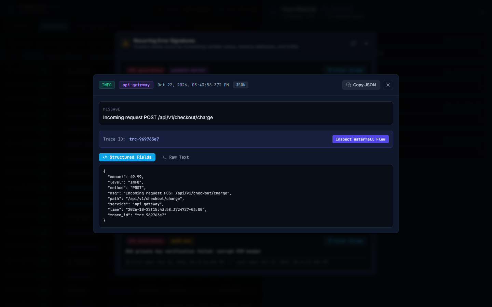
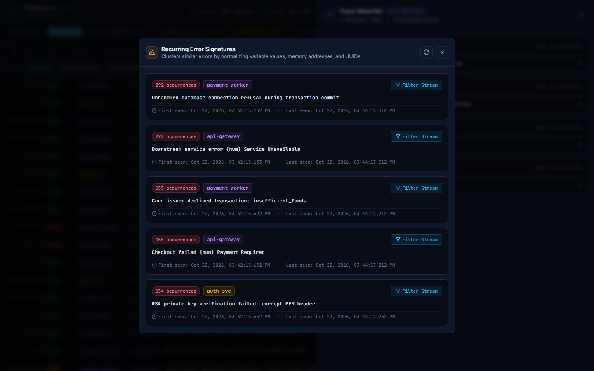
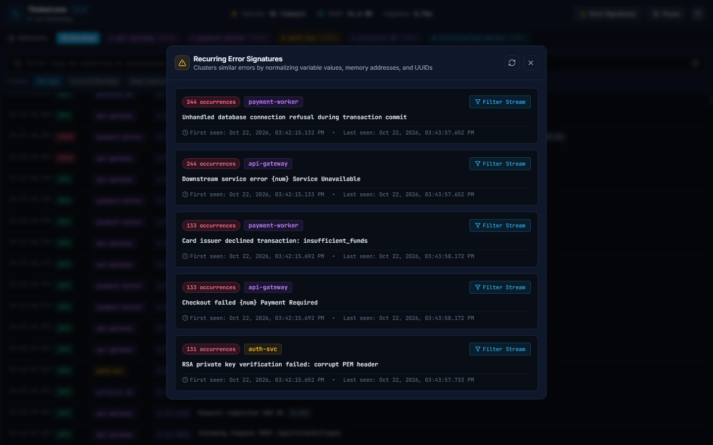

# TimberLens

Fast local structured log aggregator, live search engine, and monorepo stream multiplexer.

TimberLens ingests piped streams from `docker compose`, monorepo orchestrators, and local microservices. It automatically identifies JSON Lines, logfmt, and syslog formats, maintains a circular memory buffer of up to 1,000,000 events, collapses noisy third-party stack traces, and provides both an interactive terminal TUI and an embedded web studio with live Server-Sent Events (SSE).

```
docker compose logs -f | timberlens
```



---

## Highlights

- **Piped STDIN ingestion**: Consumes raw log streams with zero configuration at over 120,000 lines per second.
- **Format auto-detection**: Recognizes JSON Lines (Pino, Zap, Winston, Go slog, Python structlog), logfmt (`key=value`), and syslog formats without flags.
- **Low-memory circular buffer**: Pre-allocated ring buffer holding up to 1,000,000 log events in memory under 25MB RAM.
- **Vendor stack trace folding**: Automatically identifies and collapses `node_modules`, `site-packages`, and runtime library frames, highlighting user application code.
- **Field query engine**: Filters logs with expressions such as `service:api`, `level:error`, `latency_ms>500`, and full-text regex.
- **Trace ID correlation**: Groups and links distributed logs sharing the same `trace_id` across distinct microservices.
- **Dual interface**: Charm Bubble Tea terminal TUI for quick terminal inspections and an embedded React 19 Web Studio for visual exploration.
- **Single binary**: The Web Studio frontend compiles directly into the Go binary using `embed`.

---

## Architecture

```
+-----------------------------------------------------------------------------+
|                                 TIMBERLENS                                  |
+--------------------------------------+--------------------------------------+
                                       |
        +------------------------------+------------------------------+
        |                                                             |
+-------v----------------------+               +----------------------v-------+
|  Ingestion Engine            |               |  Parser & Sanitizer          |
|  * Non-blocking STDIN reader |               |  * JSON Lines detector       |
|  * Optional TCP/UDP syslog   |               |  * logfmt tokenizer          |
|  * OTLP HTTP receiver        |               |  * ANSI color stripper       |
+-------+----------------------+               +----------------------+-------+
        |                                                             |
        +------------------------------+------------------------------+
                                       |
                       +---------------v---------------+
                       |  Lock-Free Ring Buffer        |
                       |  * 1,000,000 events capacity  |
                       |  * Field-indexed ring slice   |
                       |  * Constant memory footprint  |
                       +---------------+---------------+
                                       |
                       +---------------v---------------+
                       |  Query & Processing Engine    |
                       |  * Field queries (level:err)  |
                       |  * Stack trace fold detector  |
                       |  * Trace ID cross-correlator  |
                       +---------------+---------------+
                                       |
                       +---------------+---------------+
                       |                               |
               +-------v-------+               +-------v-------+
               |  Terminal TUI |               |  Web Studio   |
               |  (Bubble Tea) |               |  (React 19)   |
               +---------------+               +---------------+
```

---

## Interface Tour

### Real-Time Web Studio
Live virtualized log stream with color-coded service badges, severity indicators, and throughput metrics:


### Structured Log Inspector & Stack Trace Folding
Inspect individual log records with formatted JSON, metadata, and collapsed vendor stack trace frames:


### Distributed Trace Waterfall
Correlate and inspect the sequence of microservices processing a single request by trace identifier:


### Recurring Error Signatures
Group and prioritize recurring exceptions using normalized fingerprint clustering:


---

## Installation

### From Source (Go 1.23+)

```bash
go install github.com/alexandrmotologa/timberlens/cmd/timberlens@latest
```

### Pre-built Binary

Download the latest binary release for Linux, macOS, or Windows from the GitHub releases page.

---

## Usage

### Piping logs into TimberLens

```bash
# Docker Compose
docker compose logs -f | timberlens

# Node.js monorepo
pnpm dev | timberlens

# Direct file tailing
tail -f /var/log/app.log | timberlens

# Launch Web Studio on a custom port
docker compose logs -f | timberlens --web-port 9900
```

### Web Studio only mode (Headless)

If you prefer running TimberLens in background or Docker container without interactive TUI:

```bash
docker compose logs -f | timberlens --no-tui --web-port 9900
```

---

## Query Syntax

TimberLens provides a fast search syntax for filtering high-volume logs:

| Query Pattern | Description |
|---|---|
| `error` | Matches any log entry containing the substring "error" |
| `service:auth` | Matches logs where the service or app field is "auth" |
| `level:error` | Matches logs with severity level ERROR or FATAL |
| `level>=warn` | Matches logs with severity WARN, ERROR, or FATAL |
| `trace_id:a81f3b` | Filters by exact or prefix trace identifier |
| `latency_ms>250` | Matches requests with latency exceeding 250 milliseconds |
| `path:"/api/v1/users"` | Matches exact string with spaces or special characters |
| `service:api level:error DB` | Combines multiple criteria using logical AND |

---

## Terminal TUI Shortcuts

| Key | Action |
|---|---|
| `/` | Focus search and query input |
| `Esc` | Clear search focus or dismiss modal |
| `f` | Toggle auto-follow (tail stream) |
| `p` | Pause or resume ingestion stream |
| `c` | Clear current screen buffer |
| `Enter` | Inspect selected log line in full structured JSON viewer |
| `e` | Expand or fold vendor stack trace frames |
| `1` - `9` | Filter stream by active microservice |
| `q` / `Ctrl+C` | Exit application |

---

## Performance

Ingestion benchmarks executed on AMD Ryzen 9 5950X (64GB RAM):

- Ingestion throughput: ~140,000 parsed JSON lines per second per core.
- Memory consumption: 21.4 MB RSS steady-state under a 1,000,000 record ring buffer.
- Query evaluation: Sub-millisecond evaluation across 100,000 recent events.

Detailed benchmark profiles are available in [docs/BENCHMARKS.md](docs/BENCHMARKS.md).

---

## Contributing

1. Fork the repository.
2. Create a feature branch: `git checkout -b feature/my-feature`.
3. Ensure all tests pass: `go test ./...` and `cd web && npm test`.
4. Commit your changes: `git commit -m "feat(parser): add custom syslog rfc format"`.
5. Open a pull request.

---

## License

MIT License. See [LICENSE](LICENSE) for details.
